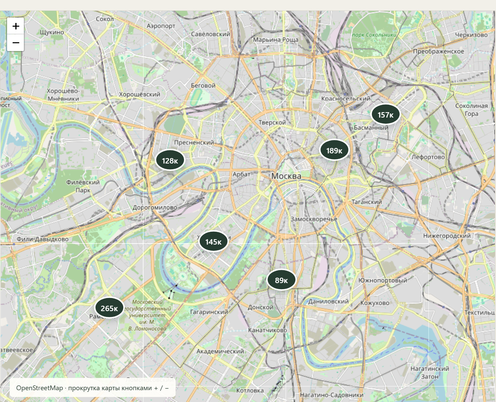

# Nestly - каталог квартир для аренды

Поиск квартир по району, количеству комнат и бюджету, избранное и заявка на просмотр.

[Открыть проект](https://memorim.github.io/nestly-apartment-rentals/)


## Возможности

- Фильтры каталога и сведения о квартире.
- Сохранение избранного в браузере.
- Форма заявки с проверкой доступности объекта на сервере и сохранением контактов.
- Фотографии квартир в первом экране и карточках.

## Стек и устройство

JavaScript, Express, Zod, встроенный SQLite в Node.js и HTML/CSS.

## Ключевые решения

- SQL-запросы связывают пользовательские значения через параметры. Перед сохранением заявки проверяется доступность квартиры.
- API по умолчанию слушает loopback; ошибки JSON не раскрывают стек сервера.
- Фильтры ограничены диапазонами; список отсортирован по цене и ID и поддерживает `limit` (1-100) и `offset`.
- Заявка вставляется одним `INSERT ... SELECT` только для доступной квартиры. `Idempotency-Key` повторяет результат прежней операции; при изменении данных с тем же ключом возвращается 409. Форма сохраняет ключ при сетевой ошибке.
- Контакты ограничены длиной и форматом; JSON - 16 КБ. В общей SQLite-БД допускаются 20 попыток отправки в минуту, затем 429 с Retry-After. Необработанные ошибки не пишут контакты в журнал.

## Локальный запуск

Node.js 24.18.0 и pnpm 11.7.0; версии закреплены в файлах проекта.

```bash
npm install --global pnpm@11.7.0
pnpm install --frozen-lockfile
pnpm start
```

Откройте `http://localhost:4600`. Поддерживается локальная работа: HOST допускает только loopback, API проверяет Host и Origin. Для разработки доступен `pnpm dev`.

## Настройки

Параметры перечислены в [.env.example](.env.example). `pnpm start` использует окружение процесса и не загружает файл автоматически. После копирования `.env` его можно загрузить явно: `node --env-file=.env server.js`.

## Данные и обновления

SQLite хранится в `data/nestly.db`. Инициализация транзакционно добавляет необязательные `request_key`/`request_hash` и уникальный индекс, сохраняя прежние заявки. Перед обновлением сохраните резервную копию; удалять БД вместо миграции не нужно.

## Проверки

```bash
pnpm test
pnpm test:contract
pnpm test:upgrade
pnpm audit --audit-level=high
pnpm exec playwright install --with-deps --only-shell chromium
pnpm test:e2e
```

Проверяются контакты, фильтры, пагинация, rate limit, откат при ошибке и одинаковый ключ двух независимых серверов с одной SQLite. Upgrade-проверка сохраняет также прежнюю заявку с контактами. Браузерные сценарии покрывают избранное, потерю ответа и повтор с тем же ключом.

Браузерные проверки запускают отдельную SQLite в памяти и не используют обычную папку `data`.

CI устанавливает зависимости по зафиксированным версиям и запускает настроенные проверки. Отдельная проверка документации находит неверные локальные ссылки и изображения. Проверка уязвимостей учитывает известные проблемы на момент запуска.

## Ограничения

- Карта Leaflet и календарь занятости работают. Владелец входит по серверному ключу; аккаунты арендаторов и платежи пока не подключены.
- Прежние API-клиенты без Idempotency-Key продолжают создавать отдельную заявку при каждом запросе. Ключи сохраняются вместе с заявками; контакты обезличиваются через CONTACT_RETENTION_DAYS (по умолчанию 90 дней), проверка раз в час при API-запросах.
- Публичный режим требует HTTPS-прокси, APP_PUBLIC_ORIGIN и APP_OWNER_TOKEN. Контакты доступны только владельцу и обезличиваются по сроку хранения. Счётчик попыток разделяется процессами одной БД. Для реальной доставки уведомлений и CRM необходимо настроить свой HTTPS-адаптер; без него очередь остаётся локальной.

## Документация

[Результаты аудита](docs/AUDIT_2026_10.md) · [Техническая документация](docs/TECHNICAL.md) · [Пример запроса и ответа](docs/API_EXAMPLE.md) · [История изменений](CHANGELOG.md)

## Версия в браузере

Открывается без установки. Изменения изолированы в памяти текущей вкладки и сбрасываются при перезагрузке. Серверные гарантии и SQLite относятся к локальному запуску, описанному выше.

Сборка: `python scripts/build_demo.py`. Проверка адаптера: `node --test demo/demo.test.mjs`.

### Карта квартир

Leaflet отображает настоящую карту OpenStreetMap и маркеры текущей выборки. Фильтры и избранное обновляют список и карту вместе; выбор цены на карте открывает ту же форму просмотра, что и карточка. Координаты показывают примерное расположение в районе, а не подтверждённую точность конкретного дома. Для тайлов нужна сеть. Регрессия фильтрации и выбора маркера проверяется командой `pnpm test:e2e`.



### Устойчивые ограничения запросов

Бюджеты попыток сохраняются в SQLite и разделяются всеми процессами, использующими одну БД. Перезапуск сервера не сбрасывает лимиты. Ответ 429 содержит Retry-After. Для нескольких узлов требуется общая служба ограничений.

### Владелец, календарь и контакты

APP_OWNER_TOKEN задаёт случайный секрет от 32 символов; Authorization: Bearer защищает GET /api/owner/inquiries, POST /api/owner/listings/:id/occupancy и DELETE /api/owner/occupancy/:id. Периоды startDate/endDate задаются как YYYY-MM-DD, дата выезда не включается. Пересечения отклоняются атомарно с 409. Публичный GET /api/listings/:id/availability раскрывает только занятость; календарь доступен под каталогом. Для публичного режима нужны APP_PUBLIC_ORIGIN (HTTPS) и TLS-прокси.

Каждая новая заявка создаёт одно событие inquiry_events; повтор заявки не создаёт новое уведомление. Рабочий канал менеджера/CRM настраивается отдельно, контакты в события не копируются.


### Кабинет владельца

При серверном запуске откройте `/owner.html`: заявки и календарь. Вход по `APP_OWNER_TOKEN`; ключ не сохраняется в localStorage или URL и удаляется при выходе. На GitHub Pages кабинет не подключён к серверной базе.

### Доставка уведомлений и CRM

`node --env-file=.env notification-worker.js` запускает отдельный обработчик на той же SQLite. Задайте `INQUIRY_WEBHOOK_URL` и случайный `INQUIRY_WEBHOOK_SECRET` от 32 символов. Очередь создаётся триггером в одной транзакции с заявкой. Доставка имеет тайм-аут 10 секунд, пять попыток с растущей задержкой, 30-секундную блокировку и восстановление после перезапуска. В кабинете видны попытки и доступен ручной повтор исчерпанных событий.

Webhook содержит `event`, `eventId`, `inquiryId`, `createdAt`, без контактов. Адаптер менеджера/CRM проверяет HMAC-SHA256 заголовка `X-Nestly-Signature` от `<X-Nestly-Timestamp>.<исходное тело>`, ограничивает возраст подписи и сохраняет `Idempotency-Key`. Доставка как минимум один раз: при потере ответа событие может прийти повторно. Переадресации запрещены; секреты и ответы не записываются в журнал. Подключение конкретного рабочего канала требует его адреса и настройки получателя.

### Защита формы заявок

Скрытое поле-ловушка отклоняет автоматическое заполнение. В публичном режиме общий лимит дополняется бюджетом пяти новых заявок на один нормализованный телефон за час. В таблице лимитов хранится HMAC от номера с серверным ключом владельца; сам номер туда не копируется. Счётчики общие для процессов одной SQLite и переживают перезапуск. Повтор с прежним Idempotency-Key не расходует контактный бюджет, но учитывается общим лимитом. Истёкшие контактные счётчики очищаются при новых обращениях. Это дополнительная защита, без обещания полного исключения спама; распределённые атаки требуют контроля на шлюзе.

[Бесплатные push-уведомления через ntfy](docs/FREE_NOTIFICATIONS.md).

Для постоянного диска задайте `NESTLY_DATA_DIRECTORY`. Сначала подключите сам диск и перенесите согласованную копию старых данных; настройка пути сама по себе не создаёт постоянное хранилище.

## Размещение и снимки — 08.11.2026

Создан бесплатный Render web-сервис для проверки сборки, но запуск остановился: приложение запрещает внешний HOST без полноценного публичного режима, а путь `/var/data/nestly` недоступен без подключённого диска. Этот сервис не считаю размещённым; постоянное хранилище остаётся незавершённым без бесплатного внешнего узла.

Визуальный интерфейс не менялся; desktop/mobile снимки выше остаются актуальными и должны обновляться при следующем изменении UI.
